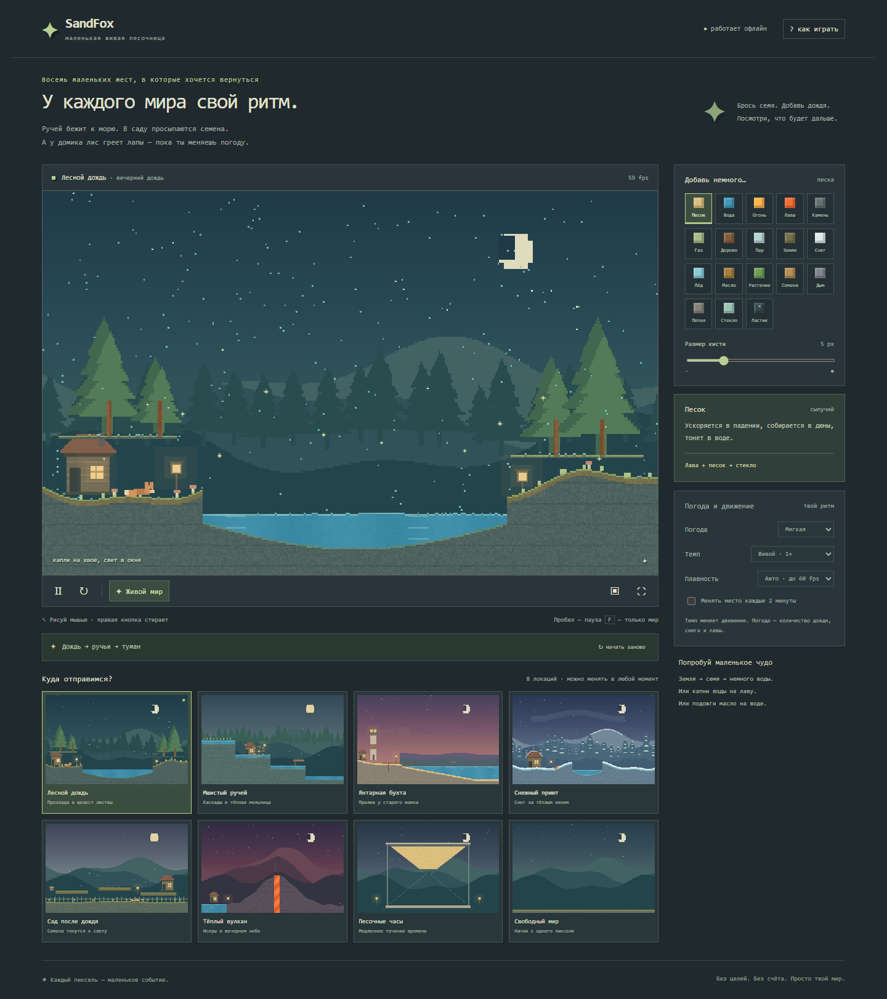
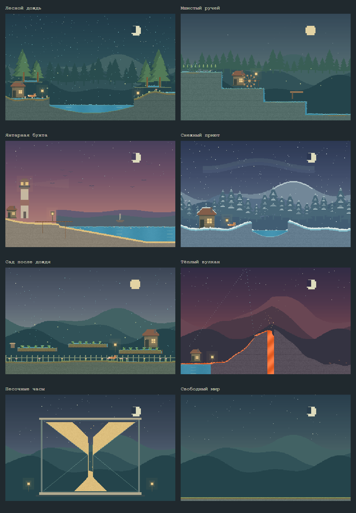

# SandFox

Лёгкий браузерный пиксельный sandbox с живыми террариумами. Чистые HTML/CSS/JS и Canvas 2D. Без библиотек, загрузок ресурсов, аналитики и сетевых запросов.

## Запуск

**Самый простой способ:** открыть `index.html` в браузере. В Windows можно дважды щёлкнуть `start.bat`. Установка не нужна, интернет не нужен.

Для локального сервера с Node.js 18+: `npm start`, затем открыть <http://127.0.0.1:4173>. Устанавливать npm-пакеты не требуется. `PORT` меняет порт.

## Живые места

Это маленький мир для наблюдения и вмешательства. Главная особенность — композиции с источниками и рециркуляцией материалов: дождь продолжает идти, вулкан извергается, песочные часы возвращают песок наверх. Сцены не зависят от того, рисует ли пользователь.

- **Лесной дождь:** хвойный лес, домик с тёплым окном, светлячки и водоём. Капли собираются внизу, часть воды возвращается паром.
- **Мшистый ручей:** родник наполняет три каскада, вода уходит в нижнюю заводь. Рядом с мостиком крутится мельничное колесо.
- **Янтарная бухта:** песчаный берег, причал и маяк. Уровень воды плавно меняется с приливом и отливом.
- **Снежный приют:** снегопад, ледяные берега открытого пруда, северное сияние и тёплая избушка.
- **Сад после дождя:** семена на грядках прорастают от воды, ограниченно ветвятся и выпускают листья.
- **Тёплый вулкан:** медленная лава, горючий газ, закатные горы. Вода позволяет вручную создавать пар и камень.
- **Песочные часы:** песок проходит через горлышко; ambient возвращает часть осевших песчинок наверх.
- **Свободный мир:** пустое пространство с землёй внизу, без автоматических источников.

17 материалов и ластик. У каждого материала есть описание поведения и подсказка реакции. Отдельно настраиваются насыщенность погоды, темп движения 0.75×–2× и частота отрисовки. Есть пауза, перезапуск, PNG-снимок, режим фона и необязательная смена сцен каждые две минуты активного времени; ускорение темпа не ускоряет эту смену. При `prefers-reduced-motion` запуск на паузе.

## Управление

| Действие | Управление |
| --- | --- |
| Рисовать | Левая кнопка мыши / палец |
| Стирать | Правая кнопка / инструмент «Ластик» |
| Выбор материала | Кнопки или 1–9, 0 — ластик |
| Кисть | Ползунок или [ и ] |
| Пауза | Пробел / кнопка Ⅱ |
| Перезапуск сцены | R / ↻ |
| Режим фона | F / ⛶ |
| Вернуть интерфейс | F / Esc / кнопка ⛶ внизу |
| Снимок | ▣, сохраняется PNG 384×240 |
| Ускорить мир | «Темп» → 1.5× или 2× |

В режиме фона нижняя панель появляется при наведении или фокусе клавиатуры. Рисовать можно даже на паузе. «Живой мир» отключает источники и рециркуляцию, оставляя клеточную физику. Горячие клавиши не перехватываются внутри настроек и справки.

## Физика и ограничения

Падающие частицы набирают скорость; путь проверяется поклеточно, без пролёта сквозь тонкие стены. Течение сохраняет направление вместо случайного дёрганья влево-вправо. Песок тяжелее жидкостей, вода тяжелее масла. Газ и дым поднимаются и дрейфуют по ветру. Диагональное движение не срезает закрытые стыки стенок. Мир ограничен краями и дном.

| Материал / взаимодействие | Что происходит |
| --- | --- |
| Песок, семена, снег, пепел | Оседают; снег и пепел легче и медленнее песка |
| Вода, масло, лава | Растекаются, различаются плотностью и вязкостью |
| Вода + лава | Камень и пар |
| Лава + песок | Стекло |
| Огонь / лава + лёд или снег | Вода |
| Огонь + дерево, растения, семена, масло | Горение, затем дым или пепел |
| Огонь + газ | Небольшая локальная вспышка |
| Семя на земле + вода рядом | Рост растения с ограниченным запасом энергии |
| Пар | Конденсируется у верхней границы или по времени |
| Дым | Рассеивается, не превращаясь в воду |
| Камень, земля, дерево, лёд, стекло | Служат неподвижными опорами |

Это художественная клеточная модель: давления, теплопроводности и полноценной гидродинамики нет. Лёд тает при контакте с горячими материалами, но вода сама не замерзает. Растение расходует запас роста, а не моделирует биологию. Ambient создаёт и удаляет частицы для непрерывной композиции; часы при рециркуляции сохраняют песок. Домики, маяк, мельница, лис, светлячки, отражения и горы — декоративные; видимые деревянные стволы на лесных платформах состоят из горючих клеток. Дым из труб — настоящий материал. Звука и сохранения состояния после закрытия страницы пока нет.

## Производительность

Поле 384×240, типизированные массивы и резкое пиксельное масштабирование. Физика работает с фиксированным шагом 60 Гц, отрисовка — до 60 fps. В эко и при устойчиво дорогих кадрах в авто — 30 fps, при этом физика сохраняет скорость. Темп масштабирует накопленное время физики. Число шагов за один кадр ограничено пятью; при сильной перегрузке мир может замедлиться, чтобы страница оставалась отзывчивой. В скрытой вкладке вычисления приостановлены; при возвращении пропущенное время не проигрывается. Пауза останавливает и декоративное движение. Реальная частота кадров и нагрузка зависят от браузера и компьютера.

## Разработка и проверка

`npm test` — проверки падения, вытеснения, реакций, конденсации, горения, сохранения частиц в закрытом мире, границ кисти и длительной работы пресетов. `node --check app.js` и `node --check engine.js` — синтаксис.

Браузерная проверка через необязательный Playwright CLI: после `npm start` выполнить `npx --package @playwright/cli playwright-cli open http://127.0.0.1:4173`, затем `npx --package @playwright/cli playwright-cli run-code --filename=tests/browser-smoke.js`. CLI нужен только для разработки. Дополнительно `tests/timing-smoke.js` проверяет скорость 60 Гц, эко, темп 2× и таймер локаций; `tests/location-smoke.js` проверяет все места после 600 шагов и создаёт обзор изображений. Скриншоты сохраняются в `output/playwright/`. Результаты и ограничения проверки — в [docs/validation.md](docs/validation.md).

- `engine.js` — независимая клеточная модель с воспроизводимым генератором случайных чисел.
- `scenery.js` — пиксельные пейзажи, материалы, освещение и декоративное движение.
- `app.js` — инструменты, UI и планировщик.
- `style.css` — адаптивный интерфейс.
- `server.cjs` — необязательный локальный сервер без зависимостей.

Для GitHub Pages: публиковать корень ветки `main` через Settings → Pages. Никакой сборки не требуется.

Лицензия MIT.
